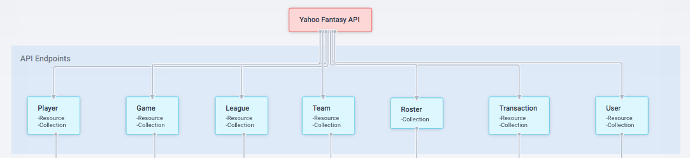
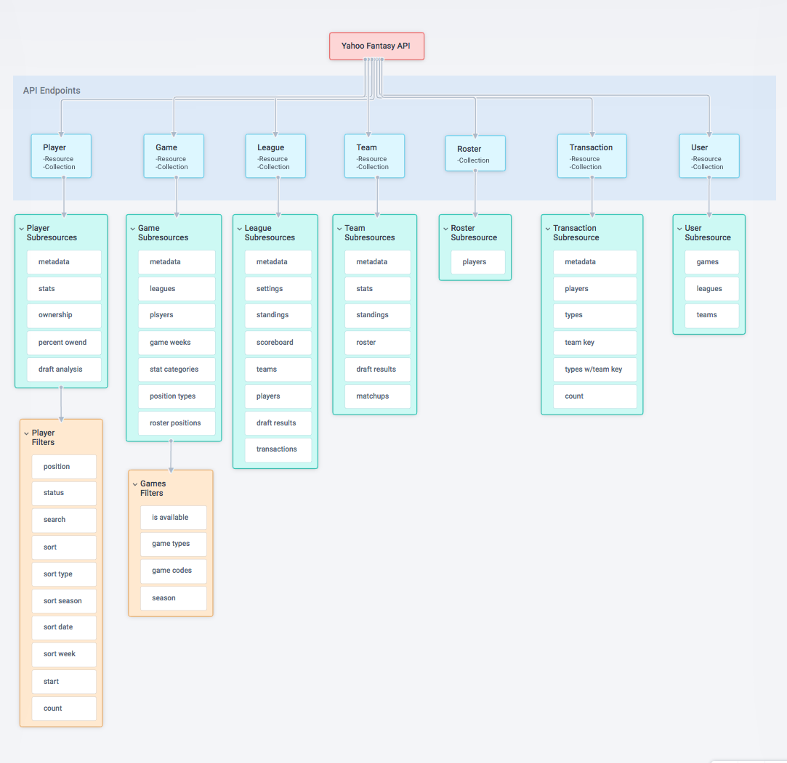

# Yahoo Fantasy Baseball Reader

**Download your Yahoo Fantasy Baseball data to JSON with a tested, read-only Node.js CLI.**

[Get started](#quick-start) · [Commands](#commands) · [Architecture](#architecture) · [Complete Yahoo API endpoint reference](#yahoo-fantasy-api-docs) · [Yahoo Fantasy Baseball Coach](#companion-project-yahoo-fantasy-baseball-coach)

> [!IMPORTANT]
> **Yahoo approval is required.** Yahoo no longer offers unrestricted self-service access to the Fantasy Sports API. Apply at [Yahoo Fantasy Sports API Access](https://sports.yahoo.com/developer/access/), complete the **API Access and Use Agreement** (the NDA-style access paperwork), and wait for Yahoo to provision your application for **Fantasy Sports — Read**. A developer Client ID alone does not grant API access. Newly approved applications are read-only; this tool cannot make roster moves or bypass Yahoo's requirements.

This project queries Yahoo Fantasy's existing XML endpoints and exports your league, lineup, available players, current matchup, statistics, and recent transactions as JSON. It does not modify Yahoo data, run a server, or require a database.

## Companion project: Yahoo Fantasy Baseball Coach

Want recommendations rather than just an export? **[Yahoo Fantasy Baseball Coach](https://github.com/edwarddistel/yahoo-fantasy-baseball-coach)** is a separate, self-hosted advisory service. It analyzes head-to-head categories, recommends start/sit decisions and potential free-agent additions, tracks weekly trends, and sends daily email reports and actionable pregame lineup alerts. It **does not automatically change your Yahoo roster**. The Coach connects directly to Yahoo and MLB; **this Reader is not a prerequisite**.

## What changed in v3.0

This is a full engineering rewrite of the existing Node.js reader. The public output keys and existing endpoint reference are retained.

| Area | Behavior |
| --- | --- |
| **Modular design** | Separate, independently testable modules for configuration, Yahoo OAuth, authenticated HTTP, XML, URL paths, data orchestration, CLI, and file storage. |
| **OAuth 2.0** | Exchanges the authorization code, reuses saved tokens, refreshes expired tokens, coalesces concurrent refreshes, and supports both legacy `oob` and registered callback URLs. |
| **Reliability** | Timeout limits, retries for transient network errors / HTTP 429 / HTTP 5xx, `Retry-After` support, and bounded Yahoo API request concurrency. |
| **Parsing and pagination** | Validates XML; normalizes singleton Yahoo collections; fetches free-agent pages and requests large player-key sets in batches. |
| **Efficiency** | Avoids fetching the same roster twice when collecting player statistics. |
| **Security** | No credentials in source code; atomic, private-permission token and export files; minimal error messages that never include provider response bodies; sensible `.gitignore` and CI permissions. |
| **Tests** | Node's built-in test runner, dependency-injected fake network responses, OAuth and retry coverage, parser and path tests, and an end-to-end mocked CLI run. |
| **Continuous integration** | GitHub Actions checks on supported Node.js LTS lines; Dependabot dependency updates. |

**Compatibility:** Your existing `config.json` keys, `credentials.json` OAuth payload, CLI `fetch-all` / `league-prefix` commands, and JSON output section names are supported. Some invalid configuration values now fail fast. `FREE_AGENTS` retains its *last page index* behavior for backward compatibility.

## Quick start

### 1. Obtain approved Yahoo API access

1. Submit an application at [Yahoo's access page](https://sports.yahoo.com/developer/access/), describing your intended data and use accurately.
2. Sign Yahoo's **API Access and Use Agreement** if required, and follow Yahoo's approval/provisioning instructions.
3. Create or update your [Yahoo developer app](https://developer.yahoo.com/apps/create/) and obtain its OAuth **Client ID** and **Client Secret** (also known as Consumer Key and Consumer Secret). Choose **Fantasy Sports — Read** when available.
4. If your approved app has not gained Fantasy Sports permissions, follow Yahoo's [confirmation process](https://sports.yahoo.com/developer/application-confirmation/).

Your Yahoo account must also authorize the approved application via OAuth. This is a separate permission step.

### 2. Install

Requirements: **Node.js 22+**, npm, an approved Yahoo Fantasy Sports API application, and a league/team you can access.

```bash
git clone https://github.com/edwarddistel/yahoo-fantasy-baseball-reader.git
cd yahoo-fantasy-baseball-reader
nvm use             # optional, if you use nvm
npm ci
cp config.json.example config.json
```

`npm ci` installs the versions in `package-lock.json`; no vendored `node_modules` are included.

### 3. Configure your Yahoo application and league

Edit the local, **git-ignored** `config.json`:

```json
{
  "CONSUMER_KEY": "YOUR_YAHOO_CLIENT_ID",
  "CONSUMER_SECRET": "YOUR_YAHOO_CLIENT_SECRET",
  "YAHOO_AUTH_CODE": "YOUR_ONE_TIME_AUTHORIZATION_CODE",
  "YAHOO_REDIRECT_URI": "oob",
  "LEAGUE_KEY": "469.l.123456",
  "TEAM": "1",
  "AUTH_FILE": "./credentials.json",
  "FREE_AGENTS": 3,
  "FREE_AGENT_PAGE_SIZE": 25
}
```

| Setting | Meaning |
| --- | --- |
| `CONSUMER_KEY` | Yahoo approved application's OAuth Client ID. |
| `CONSUMER_SECRET` | Its Client Secret. Never commit this. |
| `YAHOO_AUTH_CODE` | One-time OAuth authorization code, needed only if no valid local token file exists. Remove it after first successful exchange. |
| `YAHOO_REDIRECT_URI` | **Exact** redirect URI configured in your Yahoo app. Defaults to `oob` for older applications. Newer apps may require a registered HTTPS callback URL. |
| `LEAGUE_KEY` | Yahoo league key: `game_key.l.league_id`. The `469` shown is an example, not a permanently fixed MLB season key. |
| `TEAM` | Your team number within the league (for example `1`). |
| `AUTH_FILE` | Location of the saved OAuth token JSON, relative to `config.json` (default `credentials.json`). |
| `FREE_AGENTS` | Last zero-based page to fetch: `0` = **one** page, `3` = **four** pages. Allowed: 0–39. |
| `FREE_AGENT_PAGE_SIZE` | Players per page; default 25, allowed 1–25. |

You can also supply these settings through environment variables; they override `config.json`. To avoid saving the Client Secret in a file, export `CONSUMER_KEY`, `CONSUMER_SECRET`, `LEAGUE_KEY`, and `TEAM` in your shell and omit `config.json`. `AUTH_FILE` is resolved relative to the `--config` file path.

### 4. Authorize your Yahoo account

After Yahoo approves the app, generate the **authorization URL**:

```bash
npm run auth-url
```

Open the displayed URL in your browser, sign in with the Yahoo account that belongs to your fantasy team, and authorize the application.

- **Legacy `oob` applications:** Yahoo may display a one-time authorization code. Copy it into `YAHOO_AUTH_CODE` (or export it as an environment variable).
- **Registered HTTPS redirect URI:** Yahoo redirects to the configured URL with a `?code=...` query parameter. Copy the **code parameter**, even if your example callback page responds with a 404. The redirect URI in your configuration **must match the URI registered with Yahoo exactly**.

Run your first download. The reader exchanges the one-time code, saves `credentials.json` with private permissions, and reuses/refreshes it on subsequent runs. Remove `YAHOO_AUTH_CODE` from your local config after the token exchange.

If Yahoo denies authorization, check **both** the Fantasy Sports app entitlement and the registered redirect URI. See [Yahoo's OAuth guide](https://developer.yahoo.com/oauth2/guide/flows_authcode/).

### 5. Download your data

```bash
npm start
```

By default this writes `allMyData.json` in your current directory. The output is a snapshot, not a continuously running service. Be mindful of Yahoo's data-use, retention, and sharing restrictions in your own access agreement.

## Commands

```bash
npm start                                      # default fetch-all
node src/index.mjs fetch-all --config ./config.json --output ./my-data.json
npm run league-prefix                         # print current MLB game ID
npm run auth-url                              # print OAuth consent URL
node src/index.mjs --help
npm test                                      # run all automated tests
npm run check                                 # syntax check + tests
```

`league-prefix` only requires your approved Yahoo application credentials, not `LEAGUE_KEY` or `TEAM`. Run it after OAuth authorization to help identify the current MLB game prefix.

### JSON output

The output retains its original top-level keys:

```json
{
  "meta": { "fetchedAt": "2026-11-20T15:00:00.000Z", "week": 12 },
  "free agents": [],
  "my players": [],
  "my players' stats": {},
  "my scoreboard": [],
  "stat IDs": {},
  "current roster": {},
  "transactions": {}
}
```

The values above are illustrative; Yahoo controls the exact XML response structure, which means an empty/singleton collection may have a different shape. `getMyWeeklyStats()` is available as an internal reader method but, as in the original implementation, **weekly team stats are not exported separately by `fetch-all`**.

### Data retrieved by the downloader

| Data | Yahoo resource |
| --- | --- |
| Account games (access check) | `users;use_login=1/games` |
| Current league week | `league/{league_key}/metadata` |
| Ranked available free agents | `league/{league_key}/players;status=FA;start=…;count=…;sort=OR` |
| Your team's players | `team/{team_key}/roster/` |
| Player stat details | `players;player_keys=…;out=stats` |
| Current-week scoreboard | `league/{league_key}/scoreboard;week=…` |
| Stat-category IDs | `game/{game_key}/stat_categories` |
| Current roster resource | `team/{team_key}/roster/players` |
| Add/trade/drop transactions | `league/{league_key}/transactions;types=add,trade,drop` |

All of these are **GET** requests. This reader never changes a roster or submits a transaction.

## Architecture

```text
src/
  index.mjs     CLI entry point and exit codes
  cli.mjs       command parsing and orchestration
  config.mjs    JSON/env configuration and validation
  oauth.mjs     Yahoo OAuth authorization, token refresh, private storage
  http.mjs      authorized GETs, retries, throttling, timeouts
  xml.mjs       Yahoo XML parsing and collection normalization
  paths.mjs     validated endpoint builders
  reader.mjs    higher-level fantasy data operations
  storage.mjs   atomic, restricted-permission JSON writes
test/           node:test unit and mocked end-to-end tests
.github/        CI and Dependabot configuration
```

Each HTTP request is limited by a shared concurrency gate. Transient failures are retried with bounded delays; permanent permission failures are surfaced without logging response bodies. Tokens are refreshed in a single-flight operation to avoid simultaneous refreshes using the same rotating token.

### Test and release workflow

```bash
npm ci
npm run check
```

Tests use synthetic tokens, fake API responses, and temporary files. They do not contact Yahoo or require your credentials. GitHub Actions runs the same checks on Node.js 22 and 24. **A real authenticated Yahoo integration check remains necessary** to verify current entitlements, response formats, and league-specific behavior.

## Security and limitations

- **Never commit** `config.json`, `credentials.json`, OAuth codes, private league exports, or archives containing them. The ZIP here deliberately excludes those files, `.git/`, `node_modules/`, and old developer-console screenshots.
- Existing files with custom names may need additional entries in `.gitignore`; ignore rules do **not** erase anything from Git history. If secrets were ever committed or published, rotate/revoke them and clean the affected history separately.
- Files created by the application are written atomically with owner-only permissions on Unix-like systems (`0600`). Do not publish the generated JSON without checking the agreement and its contents.
- Yahoo can change API access policies, rate limits, or XML response structures. Approval is external to this application; automated tests alone cannot guarantee the live API works.
- The endpoint reference below is retained for compatibility and education. Its historical examples may include older seasons or deprecated capabilities; use [Yahoo's current documentation](https://sports.yahoo.com/developer/docs/) for any changed behavior.

---

## Yahoo Fantasy API Docs
### Overview of Endpoints/Resources
This reference reorganizes Yahoo's legacy [Fantasy Sports API guide](https://developer.yahoo.com/fantasysports/guide). For the latest availability and policies, consult the [current Yahoo Sports API documentation](https://sports.yahoo.com/developer/docs/). It covers the broader API, including historical write operations; **this reader only makes GET requests and does not change rosters or perform transactions**. Some historical examples use football league keys, but the resource patterns also explain baseball data.

First, an overview of the "Resources" (aka endpoints) Yahoo makes available:



- **Player**
    - Player stats & info, [docs](https://web.archive.org/web/20131003155757/https://developer.yahoo.com/fantasysports/guide/player-resource.html)
- **Game**
    - individual game data, [docs](https://web.archive.org/web/20131003155757/https://developer.yahoo.com/fantasysports/guide/game-resource.html)
- **League**
    - info about your league, [docs](https://web.archive.org/web/20131003155757/https://developer.yahoo.com/fantasysports/guide/league-resource.html)
- **Team**
    - stats, standings and roster info about your team, [docs](https://web.archive.org/web/20131003155757/https://developer.yahoo.com/fantasysports/guide/team-resource.html)
- **Roster**
    - manage your roster, [docs](https://web.archive.org/web/20131003155757/https://developer.yahoo.com/fantasysports/guide/roster-resource.html)
- **Transaction**
    - monitor or make transactions, [docs](https://web.archive.org/web/20131003155757/https://developer.yahoo.com/fantasysports/guide/transaction-resource.html)
- **User**
    - info about the Yahoo user, [docs](https://web.archive.org/web/20131003155757/https://developer.yahoo.com/fantasysports/guide/user-resource.html)

Except for "Roster", all other 6 endpoints also offer groups of items called "Collections" (instead of "Resources"). Basically the same content, just more than one item at a time.

### Subresources

Each endpoint has subresources that can be accessed:



### Base URL

For all the links below, the base URL is https://fantasysports.yahooapis.com/fantasy/v2

#### Player subresources
- With the Player API, you can obtain the player (athlete) related information, such as their name, professional team, and eligible positions.
- E.g. https://fantasysports.yahooapis.com/fantasy/v2/league/223.l.431/players;player_keys=223.p.5479

| Name | Description | URI | Sample |
| ---- | ----------- | --- | ------ |
| metadata | Includes player key, id, name, editorial information, image, eligible positions, etc. | /fantasy/v2/player/{player_key}/metadata | Drew Brees's info in the 2009 season: /player/223.p.5479 |
| stats | Player stats and points (if in a league context). | Season stats: /fantasy/v2/player/{player_key}/stats Week stats: /fantasy/v2/player/{player_key}/stats;type=week;week={week} Here {week} is a non-zero integer. | Drew Brees's info and stats in the 2009 season: /player/223.p.5479/stats |
| ownership | The player ownership status within a league (whether they're owned by a team, on waivers, or free agents). Only relevant within a league. | /fantasy/v2/league/{league_key}/players;player_keys={player_key}/ownership | /league/223.l.431/players;player_keys=223.p.5479/ownership |
| percent_owned | Data about ownership percentage of the player | /fantasy/v2/player/{player_key}/percent_owned | The percentage of leagues in which Drew Brees was owned in the 2009 game: /player/223.p.5479/percent_owned |
| draft_analysis | Average pick, Average round and Percent Drafted. | /fantasy/v2/player/{player_key}/draft_analysis | Yahoo! fantasy draft information for Drew Brees in 2009: /player/223.p.5479/draft_analysis |

#### Player collection
- "With the Players API, you can obtain information from a collection of players simultaneously."
- `/players;player_keys={player_key1},{player_key2};out={sub_resource_1},{sub_resource_2}`


#### Player filters
| Filter parameter | Filter parameter values | Usage |
| ---------------- | ----------------------- | ----- |
| position | Valid player positions | /players;position=QB (Note: Applied only in a league's context) |
| status | A (all available players), FA (free agents only), W (waivers only), T (all taken players), K (keepers only) | /players;status=A (Note: Applied only in a league's context) |
| search | player name | /players;search=smith (Note: Applied only in a league's context) |
| sort | {stat_id}, NAME (last, first), OR (overall rank), AR (actual rank), PTS (fantasy points) | /players;sort=60 (Note: Applied only in a league's context) |
| sort_type | season, date (baseball, basketball, and hockey only), week (football only), lastweek (baseball, basketball, and hockey only), lastmonth | /players;sort_type=season (Note: Applied only in a league's context) |
| sort_season | year | /players;sort_type=season;sort_season=2010  (Note: Applied only in a league's context)
| sort_date (baseball, basketball, and hockey only) | YYYY-MM-DD | /players;sort_type=date;sort_date=2010-02-01  (Note: Applied only in a league's context) |
| sort_week (football only) | week | /players;sort_type=week;sort_week=10
| start | Any integer 0 or greater | /players;start=25 (Note: Applied only in a league's context) |
| count | Any integer b/t 0 & 25 | /players;count=5 (Note: Applied only in a league's context) |

#### Game subresources
- With the Game API, you can obtain the fantasy game related information, like the fantasy game name, the Yahoo! game code, and season.
- E.g. /game/{game_key}/{sub_resource}

| Name | Description | URI | Sample |
| ---- | ----------- | --- | ------ |
| metadata | Includes game key, code, name, url, type and season. | /fantasy/v2/game/{game_key}/metadata | The 2009 Football PLUS game: /game/223|
| leagues | Fetch specified leagues under a game. | /fantasy/v2/game/{game_key}/leagues;league_keys={league_key1},{league_key2} | A publicly viewable league within the 2009 football plus game: /game/223/leagues;league_keys=223.l.431|
| players | Fetch specified players under a game. | /fantasy/v2/game/{game_key}/players;player_keys={player_key1},{player_key2} | Brett Favre's information from the 2009 football plus game: /game/223/players;player_keys=223.p.1025|
| game_weeks | Start and end date information for each week in the game | /fantasy/v2/game/{game_key}/game_weeks | NFL game weeks /game/nfl/game_weeks|
| stat_categories | Detailed description of all available stat categories for the game. | /fantasy/v2/game/{game_key}/stat_categories | NFL stat categories /game/nfl/stat_categories|
| position_types | Detailed description of all player position types for the game. | /fantasy/v2/game/{game_key}/position_types | NFL position types /game/nfl/position_types|
| roster_positions | Detailed description of all roster positions for the game. | /fantasy/v2/game/{game_key}/roster_positions | NFL roster positions /game/nfl/roster_positions |

#### Games collection
- With the Games API, you can obtain information from a collection of games simultaneously. Each element beneath the Games Collection will be a Game Resource
- E.g. https://fantasysports.yahooapis.com/fantasy/v2/games;game_keys={game_key1},{game_key2};out={sub_resource_1},{sub_resource_2}

#### Games filters
| Filter parameter | Filter parameter values | Usage |
| ---------------- | ----------------------- | ----- |
| is_available | 1 to only show games currently in season | /games;is_available=1 |
| game_types | full|pickem-team|pickem-group|pickem-team-list | /games;game_types=full,pickem-team |
| game_codes | Any valid game codes | /games;game_codes=nfl,mlb |
| seasons | Any valid seasons | /games;seasons=2011,2012 |

#### League subresources
- With the League API, you can obtain the league related information, like the league name, the number of teams, the draft status, et cetera.
- E.g. https://fantasysports.yahooapis.com/fantasy/v2/league/223.l.431 

| Name | Description | URI | Sample |
| ---- | ----------- | --- | ------ |
| metadata | Includes league key, id, name, url, draft status, number of teams, and current week information. | /fantasy/v2/league/{league_key}/metadata |  /league/223.l.431 |
| settings | League settings. For instance, draft type, scoring type, roster positions, stat categories and modifiers, divisions. | /fantasy/v2/league/{league_key}/settings |  /league/223.l.431/settings |
| standings | Ranking of teams within the league. Accepts Teams as a sub-resource, and includes team_standings data by default beneath the teams | /fantasy/v2/league/{league_key}/standings |  /league/223.l.431/standings |
| scoreboard | League scoreboard. Accepts Matchups as a sub-resource, which in turn accept Teams as a sub-resource. Includes team_stats data by default. | Scoreboard for current week: /fantasy/v2/league/{league_key}/scoreboard | Scoreboard for a particular week: /fantasy/v2/league/{league_key}/scoreboard;week={week} |
| teams | All teams in the league. | /fantasy/v2/league/{league_key}/teams |  /league/223.l.431/teams |
| players | The league's eligible players. | /fantasy/v2/league/{league_key}/players |  /league/223.l.431/players |
| draftresults | Draft results for all teams in the league. | /fantasy/v2/league/{league_key}/draftresults |  /league/223.l.431/draftresults |
| transactions | League transactions -- adds, drops, and trades. | /fantasy/v2/league/{league_key}/transactions |  /league/223.l.431/transactions |

#### Leagues collection
- With the Leagues API, you can obtain information from a collection of leagues simultaneously.
- /leagues;league_keys={league_key1},{league_key2}/{sub_resource}

#### Team subresources
- The Team APIs allow you to retrieve information about a team within our fantasy games.
- E.g. https://fantasysports.yahooapis.com/fantasy/v2/team/223.l.431.t.1

| Name | Description | URI | Sample |
| ---- | ----------- | --- | ------ |
| metadata | Includes team key, id, name, url, division ID, logos, and team manager information. | /fantasy/v2/team/{team_key}/metadata | /team/223.l.431.t.9 |
| stats | Team statistical data and points. | Season stats: /fantasy/v2/team/{team_key}/stats Week stats: /fantasy/v2/team/{team_key}/stats;type=week;week={week} Here {week} is a non-zero integer, or current for the current week. | /team/223.l.431.t.9/stats;type=week;week=2 |
| standings | Team rank, wins, losses, ties, and winning percentage (as well as divisional data if applicable). | /fantasy/v2/team/{team_key}/standings | /team/223.l.431.t.9/standings |
| roster | Team roster. Accepts a week parameter. Also accepts Players as a sub-resource (included by default) | Roster for a particular week: /fantasy/v2/team/{team_key}/roster;week={week} Here {week} is a non-zero integer. If week is current, or isn't provided, defaults to current week. | /team/223.l.431.t.9/roster;week=2 - The week 2 roster for team 223.l.431.t.9 |
| draftresults | List of players drafted by the team. | /fantasy/v2/team/{team_key}/draftresults | /team/223.l.431.t.9/draftresults |
| matchups | All the matchups this team has scheduled (for H2H leagues). | All matchups: /fantasy/v2/team/{team_key}/matchups Particular weeks: /fantasy/v2/team/{team_key}/matchups;weeks=1,3,6 | /team/223.l.431.t.9/matchups;weeks=1,3,6 |

#### Teams collection
- With the Teams API, you can obtain information from a collection of teams simultaneously.
- /teams;team_keys={team_key1},{team_key2};out={sub_resource_1},{sub_resource_2}

#### Roster subresources
- You can use this API to edit your lineup by PUTting up new positions for the players on a roster.
- https://fantasysports.yahooapis.com/fantasy/v2/team//roster;date=2011-05-01 

| Name | Description | URI | Sample |
| ---- | ----------- | --- | ------ |
| players | Access the players collection within the roster. | /fantasy/v2/team/{team_key}/roster/players | /team/223.l.431.t.9/roster/players |


#### Transaction subresources
- With the Transaction API, you can obtain information about transactions (adds, drops, trades, and league settings changes) performed on a league
- E.g. https://fantasysports.yahooapis.com/fantasy/v2/transaction/257.l.193.tr.2 

| Name | Description | URI | Sample |
| ---- | ----------- | --- | ------ |
| metadata | Includes transaction key, id, type, timestamp, status, players (not displayed for all transaction types) | /fantasy/v2/transaction/{transaction_key}/metadata | An add/drop transaction: /transaction/223.l.431.tr.26 |
| players | Players that are part of the transaction. The Player Resources will include a transaction data element by default. | /fantasy/v2/transaction/{transaction_key}/players | /transaction/223.l.431.tr.26/players |


#### Transaction collection
- With the Transactions API, you can obtain information via GET from a collection of transactions simultaneously.
- E.g. /transactions;transaction_keys={transaction_key1},{transaction_key2};out={sub_resource_1},{sub_resource_2}

#### Transaction filters
| Filter parameter | Filter parameter values | Usage |
| ---------------- | ----------------------- | ----- |
| type | add,drop,commish,trade | /transactions;type=add |
| types | Any valid types | /transactions;types=add,trade |
| team_key | A team_key within the league | /transactions;team_key=257.l.193.t.1 |
| type with team_key | waiver,pending_trade | You can only use these options when also providing the team_key, ie /transactions;team_key=257.l.193.t.1;type=waiver |
| count | Any integer greater than 0 | /transactions;count=5 |


#### User subresources
- With the User API, you can retrieve fantasy information for a particular Yahoo! user. It is generally recommended that you instead use the Users collection, passing along the use_login flag.

| Name | Description | URI | Sample |
| ---- | ----------- | --- | ------ |
| games | Fetch the Games in which the user has played. Additionally accepts flags is_available to only return available games. | /fantasy/v2/users;use_login=1/games | /users;use_login=1/games |
| games/leagues | Fetch leagues that the user belongs to in one or more games. The leagues will be scoped to the user. This will throw an error if any of the specified games do not support league sub-resources. | /fantasy/v2/users;use_login=1/games;game_keys={game_key1},{game_key2}/leagues | /users;use_login=1/games;game_keys=223/leagues |
| games/teams | Fetch teams owned by the user in one or more games. The teams will be scoped to the user. This will throw an error if any of the specified games do not support team sub-resources. | /fantasy/v2/users;use_login=1/games;game_keys={game_key1},{game_key2}/teams |

#### User resource/collection
- With the User API, you can retrieve fantasy information for a particular Yahoo! user. It is generally recommended that you instead use the Users collection, passing along the use_login flag.

| Name | Description | URI | Sample |
| ---- | ----------- | --- | ------ |
| games | Fetch the Games in which the user has played. Additionally accepts flags is_available to only return available games. | /fantasy/v2/users;use_login=1/games | /users;use_login=1/games |
| games/leagues | Fetch leagues that the user belongs to in one or more games. The leagues will be scoped to the user. This will throw an error if any of the specified games do not support league sub-resources. | /fantasy/v2/users;use_login=1/games;game_keys={game_key1},{game_key2}/leagues | /users;use_login=1/games;game_keys=223/leagues |
| games/teams | Fetch teams owned by the user in one or more games. The teams will be scoped to the user. This will throw an error if any of the specified games do not support team sub-resources. | /fantasy/v2/users;use_login=1/games;game_keys={game_key1},{game_key2}/teams | /users;use_login=1/games;game_keys=223/teams |
